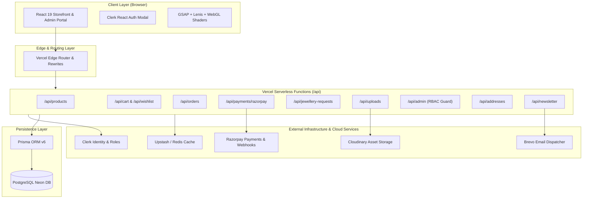
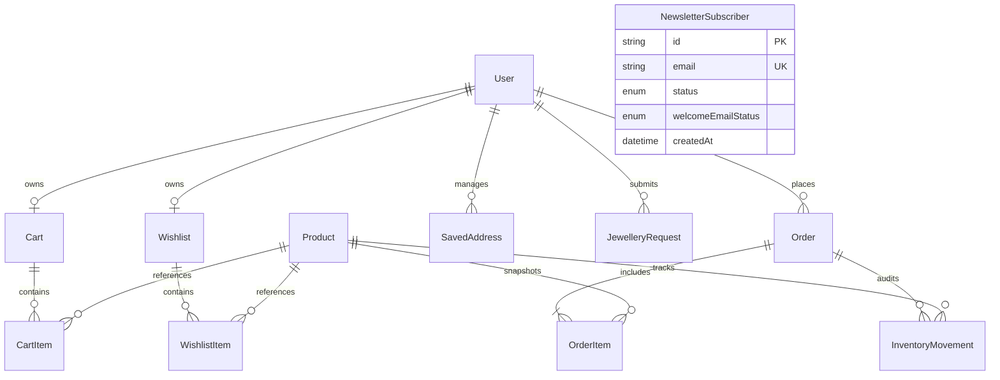
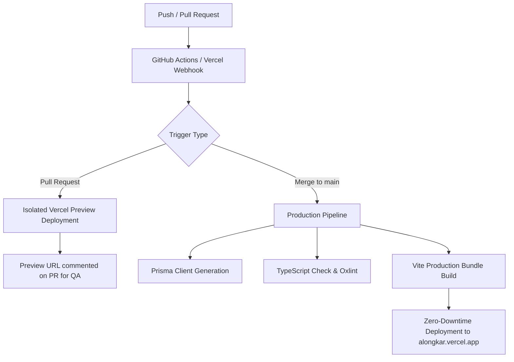

<div align="center">

# ✨ Alongkar (অলংকার) ✨

### *Timeless Heritage • Modern Grace • Handcrafted Luxury*

A state-of-the-art, full-stack luxury jewellery e-commerce platform and bespoke royal bridal atelier. Inspired by royal Indian heritage, 24K micron gold craftsmanship, Polki, Kundan, and contemporary minimalist elegance.

[](https://alongkar.vercel.app)
[](https://react.dev)
[](https://www.typescriptlang.org/)
[](https://tailwindcss.com)
[](https://vite.dev)
[](https://www.prisma.io/)
[](https://neon.tech/)
[](https://razorpay.com/)
[](https://clerk.com)
[](https://cloudinary.com/)
[](https://oxc.rs/)
[](https://github.com/Snehasish321/Alongkar/pulls)

<p align="center">
  <a href="#-about-alongkar">About</a> •
  <a href="#-key-features">Key Features</a> •
  <a href="#-tech-stack">Tech Stack</a> •
  <a href="#-system-architecture">Architecture</a> •
  <a href="#-project-structure">Project Structure</a> •
  <a href="#-api-endpoints">API Endpoints</a> •
  <a href="#-database-schema">Data Models</a> •
  <a href="#-getting-started">Getting Started</a> •
  <a href="#-environment-variables">Environment Variables</a> •
  <a href="#-testing--verification">Testing & Quality</a> •
  <a href="#-ci--cd-deployment">Deployment</a> •
  <a href="#-contributing">Contributing</a>
</p>

---

</div>

## 📖 About Alongkar

**Alongkar (অলংকার)** is an enterprise-grade luxury jewellery e-commerce platform and digital bespoke atelier. Rooted in centuries-old artisanal traditions of Bengal and royal India—including intricate filigree, Kundan stone setting, royal Polki necklaces, temple jewels, and 24K micron electroplated gold finishes—Alongkar translates heritage opulence into a blazing-fast, digital-first shopping journey.

Engineered with a modern full-stack architecture—**React 19**, **Tailwind CSS v4**, **TypeScript**, **Vite 8**, **Prisma ORM 6**, and **Vercel Serverless Functions**—Alongkar pairs editorial aesthetics (custom WebGL shader backgrounds, GSAP physics, Lenis smooth scrolling) with mission-critical commerce infrastructure (exact Decimal financial calculations, double-entry inventory audit logging, Razorpay payment reconciliation, and Clerk RBAC).

---

## 💎 Key Features

### 👑 1. Editorial Luxury Aesthetics & Motion
- **GPU-Accelerated WebGL Backdrops**: Native GLSL shader backdrops including the *Blossom Sky* simplex noise flow and *Garnet Silk Prism* Oklab perceptual color space engine.
- **Micro-Interactions & Physics**: Powered by **GSAP** and **Lenis** smooth scrolling for zero-jank browsing, plus **Lottie** animated seals and Spell UI `BlurReveal` progressive Gaussian text reveals.
- **Royal Bordeaux & Champagne Gold Theme**: Curated design tokens (`#140104` Bordeaux Noir, `#2A1E27` Deep Velvet, and shimmering 24K gold leaf gradients).

### 🛍️ 2. Dynamic Storefront & Catalog Experience
- **Live Search & Command Palette**: Instant fuzzy search with `Cmd/Ctrl + K` global shortcut, category filters, and live stock indicator pills.
- **Interactive Drawers & Modals**: Slide-over persistent Cart Drawer and Wishlist Drawer with real-time updates, free shipping threshold progress bars, and promotional coupon support (`ROYAL10`).
- **Product Inspection**: High-resolution image zoom, dual-photograph hover crossfades, material hallmark guarantees, and stock alerts.

### 💳 3. Financial Accuracy & Razorpay Payments
- **Zero-Drift Decimal Math**: Subtotals, dynamic coupons, prepaid incentives (`PREPAID5`), delivery charges, and taxes are snapshot as exact decimals in PostgreSQL to eliminate float rounding errors.
- **Razorpay Integration**: Serverless order creation, HMAC-SHA256 signature verification, idempotent payment callbacks, automatic refund reconciliation, and webhook synchronization.
- **Idempotency Protection**: Duplicate order submission guards via unique idempotency keys.

### 📦 4. Inventory Auditing & Order Lifecycle Management
- **Audit Logging via `InventoryMovement`**: Every order placement atomically records `DEDUCTION` movements. Cancellations and returns trigger idempotent `RESTORATION` entries to prevent stock leaks.
- **Three-Tier Status Tracking**: Independent, finite-state tracking for `OrderStatus`, `PaymentStatus`, and `ShippingStatus` with customer-facing status badges.
- **Customer Cancellation Workflow**: Self-serve cancellation within allowable windows with automated stock restoration and refund queueing.

### 💍 5. Bespoke Jewellery Request Atelier
- **Custom Design Submissions**: Patrons can submit bespoke bridal and heirloom jewellery requests with reference image uploads, budget ranges, and custom specifications.
- **Cloudinary Multipart Media Pipeline**: Secure server-side image upload via Busboy multipart streaming directly to Cloudinary CDN.
- **Quotation & Multi-Stage Billing**: Interactive admin review workflow supporting quotes, advance deposits (`ADVANCE_PENDING` -> `ADVANCE_PAID`), sourcing tracking, and balance settlements.

### 🛡️ 6. Executive Admin Suite (`/admin`)
- **Role-Based Access Control (RBAC)**: Protected via Clerk metadata (`isAdmin`), preventing unauthorized access with strict HTTP 403 enforcement.
- **Operational Dashboards**: Order fulfillment manager, tracking number assignment (Shiprocket-ready), customer analytics, dynamic product catalog manager, and bespoke request quoting.

### 📬 7. Address Book & Transactional Communications
- **Multi-Address Management**: Save multiple shipping addresses with default address designations and address validation.
- **Brevo Email Engine**: Automated transactional welcome emails for VIP newsletter subscribers with persistent consent logs.

---

## 🛠️ Tech Stack

| Domain | Technology / Library | Purpose |
| :--- | :--- | :--- |
| **Frontend Framework** | [React 19](https://react.dev/) + [TypeScript 5.8](https://www.typescriptlang.org/) | Next-generation React core with strict type safety |
| **Build Tool & Bundler** | [Vite 8](https://vite.dev/) (Rolldown engine) | Blazing-fast HMR and optimized tree-shaken chunks |
| **Styling & Design System** | [Tailwind CSS v4](https://tailwindcss.com/) + PostCSS | Zero-runtime CSS design system with custom luxury tokens |
| **Routing** | [React Router v7](https://reactrouter.com/) | Client-side routing with route guards and layout shells |
| **Physics & Motion** | [GSAP](https://greensock.com/) + [Lenis](https://lenis.darkroom.engineering/) + [Lottie](https://lottiefiles.com/) | Inertial smooth scroll, canvas shader engines, vector micro-interactions |
| **Icons & Typography** | [Lucide React](https://lucide.dev/) + [Geist Font](https://vercel.com/font) | Modern iconography and editorial typography |
| **Backend & API** | [Vercel Serverless Functions](https://vercel.com/docs/functions) (Node.js/TS) | Modular RESTful serverless microservices in `/api` |
| **ORM & Database** | [Prisma ORM 6](https://www.prisma.io/) + [PostgreSQL](https://neon.tech/) | Type-safe database queries with migrations and connection pooling |
| **Caching & Rate Limiting** | [Redis](https://redis.io/) via [@upstash/redis](https://upstash.com/) & `ioredis` | High-throughput query caching and security rate limiting |
| **Payment Gateway** | [Razorpay](https://razorpay.com/) Node SDK | Checkout orders, payment verification, and refund reconciliation |
| **Authentication** | [@clerk/react](https://clerk.com/) & [@clerk/backend](https://clerk.com/) | OAuth & passwordless authentication with RBAC session tokens |
| **Media & Storage** | [Cloudinary](https://cloudinary.com/) + `busboy` | Secure streaming image uploads and cloud CDN delivery |
| **Transactional Email** | [Brevo API](https://www.brevo.com/) (Sendinblue) | Transactional emails, welcome automations, and subscriber queue |
| **Code Quality & Linter** | [Oxlint](https://oxc.rs/) | Rust-powered high-speed linter (0 errors baseline) |
| **Deployment & CI/CD** | [Vercel](https://vercel.com/) | Automatic production deploys and isolated PR preview builds |

---

## 🏛️ System Architecture



---

## 📂 Project Structure

```
Alongkar/
├── api/                             # Vercel Serverless Functions (Node.js & TypeScript)
│   ├── _admin/                      # Admin controllers (analytics, customers, orders, inventory)
│   ├── _utils/                      # Shared API utilities (auth guards, DB client, Decimal math, email)
│   ├── payments/                    # Razorpay payment handler and webhook processor
│   ├── addresses.ts                 # Address book CRUD API
│   ├── admin.ts                     # Admin master dispatcher router
│   ├── cart.ts                      # Persistent cart synchronization API
│   ├── health.ts                    # System health diagnostics endpoint
│   ├── jewellery-requests.ts        # Bespoke jewellery request lifecycle API
│   ├── newsletter.ts                # Newsletter subscriber & email queue API
│   ├── orders.ts                    # Order placement, status tracking & cancellation API
│   ├── products.ts                  # Storefront & catalog product querying API
│   ├── uploads.ts                   # Busboy multipart streaming upload to Cloudinary
│   └── wishlist.ts                  # Persistent wishlist synchronization API
├── prisma/                          # Database schema & migration engine
│   ├── migrations/                  # Historical SQL migration logs
│   └── schema.prisma                # Full database model definitions & relations
├── public/                          # Static assets, branding & web manifest
├── scripts/                         # Automated integration, security, & reconciliation tests
│   ├── test-admin-orders.ts         # Admin order fulfillment & status testing
│   ├── test-phase1j-razorpay.ts     # Razorpay checkout & webhook verification
│   ├── test-phase3j-refund-reconciliation.test.ts # Refund reconciliation test suite
│   ├── test-customer-cancellation-workflow.test.ts # Cancellation & inventory restoration test
│   └── set-admin.js                 # Admin user provisioning utility script
├── src/
│   ├── assets/                      # Lottie animations, vector logos, & editorial images
│   ├── components/
│   │   ├── admin/                   # Admin UI modals, data tables, and metrics widgets
│   │   ├── auth/                    # Clerk auth dialogs & user profile menu
│   │   ├── cart/                    # Cart items, promo code inputs, & financial summary
│   │   ├── common/                  # Shared badges, spinner overlays, and SEO tags
│   │   ├── home/                    # HeroSection, CategoryGrid, CuratedCollections, PatronReviews
│   │   ├── layout/                  # Navbar, AnnouncementBar, BottomNav, Footer, Drawers
│   │   ├── orders/                  # Customer order tracking & cancellation dialogs
│   │   ├── products/                # ProductCard, ProductGrid, QuickViewModal, FilterBar
│   │   └── ui/                      # WebGL BlossomSky, GarnetSilkPrism, BlurReveal, Button, Input
│   ├── context/                     # Global state (CartContext, WishlistContext, ToastContext)
│   ├── data/                        # Static fallback catalog & collection taxonomies
│   ├── hooks/                       # Custom React hooks (useDebounce, useMediaQuery, useLenis)
│   ├── lib/                         # Client utility functions (cn, formatPrice, apiClient, analytics)
│   ├── pages/                       # Route views
│   │   ├── admin/                   # AdminOrdersPage, AdminProductsPage, AdminCustomersPage, etc.
│   │   ├── CartPage.tsx             # Multi-step checkout & payment selection page
│   │   ├── HomePage.tsx             # Editorial landing page
│   │   ├── JewelleryRequestsPage.tsx# Patron custom jewellery request tracking page
│   │   ├── OrdersPage.tsx           # Customer orders timeline & detail history page
│   │   ├── ProductDetailPage.tsx    # Single product showcase with gallery & specifications
│   │   ├── RequestJewelleryPage.tsx # Bespoke custom jewellery submission form
│   │   ├── ShopPage.tsx             # Full jewelry catalog with sorting & multi-faceted filters
│   │   └── WishlistPage.tsx         # Patron saved pieces view
│   ├── types/                       # Shared TypeScript types & API response contracts
│   ├── App.tsx                      # Route declarations & layout wrapper
│   ├── main.tsx                     # React root bootstrap & Clerk provider configuration
│   └── index.css                    # Tailwind CSS v4 directives & luxury design tokens
├── .env.example                     # Environment variables configuration template
├── package.json                     # Project dependencies & build scripts
├── tsconfig.json                    # TypeScript compiler workspace project references
├── vercel.json                      # Vercel deployment configuration & serverless rewrites
└── vite.config.ts                   # Vite bundler options, plugins & Rolldown chunking
```

---

## 📡 API Endpoints

All backend endpoints are deployed as serverless functions and configured with path rewrites in `vercel.json`:

| Route | Methods | Auth Required | Description |
| :--- | :---: | :---: | :--- |
| `/api/products` | `GET`, `POST` | Admin for `POST` | Query catalog with filters, search, and pagination |
| `/api/cart` | `GET`, `POST`, `DELETE` | Yes (User) | Synchronize customer cart items with PostgreSQL |
| `/api/wishlist` | `GET`, `POST`, `DELETE` | Yes (User) | Synchronize customer wishlist items |
| `/api/orders` | `GET`, `POST`, `PATCH` | Yes (User) | Place idempotent order, fetch history, customer cancel |
| `/api/payments/razorpay` | `POST` | Yes (User) | Create Razorpay order, verify HMAC signature |
| `/api/jewellery-requests`| `GET`, `POST` | Yes (User) | Submit bespoke design request, retrieve request timeline |
| `/api/addresses` | `GET`, `POST`, `PUT`, `DELETE` | Yes (User) | Saved customer shipping addresses management |
| `/api/uploads` | `POST` | Yes (User) | Stream image to Cloudinary (products or custom requests) |
| `/api/newsletter` | `POST` | Public | Newsletter subscription with Brevo transactional email |
| `/api/admin` | `GET`, `POST`, `PATCH` | Yes (Admin RBAC) | Master administrative dispatcher (Orders, Products, Requests, Metrics) |
| `/api/health` | `GET` | Public | Database, cache, and system health status |

---

## 🗄️ Database Schema

Managed via **Prisma ORM** against **PostgreSQL**:



### Core Persistence Highlights:
- **`Order` & `OrderItem`**: Stores financial Decimal snapshots (`subtotal`, `discountTotal`, `shippingFee`, `grandTotal`) alongside address snapshots so price changes to products never mutate historical customer invoices.
- **`InventoryMovement`**: Double-entry ledger recording all stock mutations (`DEDUCTION`, `RESTORATION_CANCELLATION`, `RESTORATION_RETURN`) with unique idempotency keys.
- **`JewelleryRequest`**: Tracks the custom bespoke jewellery journey from inspiration image upload to quotation, advance deposit, sourcing, and delivery.

---

## 🚀 Getting Started

### Prerequisites
- **Node.js**: `v18.0.0` or higher
- **PostgreSQL**: Local instance or cloud database (e.g., [Neon](https://neon.tech/), Supabase)
- **Package Manager**: `npm` (or `pnpm` / `yarn`)

### 1. Clone the Repository
```bash
git clone https://github.com/Snehasish321/Alongkar.git
cd Alongkar
```

### 2. Install Dependencies
```bash
npm install
```

### 3. Configure Environment Variables
Create your local `.env` configuration file:
```bash
cp .env.example .env
```
Fill in your credentials (see [Environment Variables](#-environment-variables) below).

### 4. Database Setup & Migration
Generate the Prisma Client and apply migrations to your PostgreSQL database:
```bash
# Generate Prisma Client
npx prisma generate

# Apply migrations
npx prisma migrate deploy
```

### 5. Launch Local Development Server
```bash
npm run dev
```
Open [http://localhost:5173](http://localhost:5173) in your browser.

### 6. Code Verification & Production Build
```bash
# Fast Oxlint code analysis
npm run lint

# TypeScript verification + Prisma generation + Production Vite build
npm run build

# Preview production build locally
npm run preview
```

---

## 🔐 Environment Variables

Ensure the following variables are configured in your `.env` and Vercel project settings:

| Variable | Description | Required | Scope |
| :--- | :--- | :---: | :--- |
| `VITE_CLERK_PUBLISHABLE_KEY` | Clerk Authentication publishable key | **Yes** | Client (`VITE_`) |
| `CLERK_SECRET_KEY` | Clerk backend secret key for token & role validation | **Yes** | Server-side |
| `DATABASE_URL` | PostgreSQL connection string (pooled / PgBouncer) | **Yes** | Server-side |
| `DIRECT_URL` | PostgreSQL direct connection string for Prisma migrations | **Yes** | Server-side |
| `RAZORPAY_KEY_ID` | Razorpay Merchant Key ID | **Yes** | Client / Server |
| `RAZORPAY_KEY_SECRET` | Razorpay Merchant Secret for HMAC verification | **Yes** | Server-side |
| `CLOUDINARY_CLOUD_NAME` | Cloudinary cloud identifier | **Yes** | Server-side |
| `CLOUDINARY_API_KEY` | Cloudinary API Key | **Yes** | Server-side |
| `CLOUDINARY_API_SECRET` | Cloudinary API Secret | **Yes** | Server-side |
| `BREVO_API_KEY` | Brevo API key for transactional emails | Optional | Server-side |
| `BREVO_SENDER_EMAIL` | Verified sender email address in Brevo | Optional | Server-side |
| `BREVO_SENDER_NAME` | Display name for outgoing emails (Alongkar) | Optional | Server-side |
| `BREVO_ENABLE_WELCOME_EMAIL`| Enable/disable automated newsletter emails (`true`/`false`) | Optional | Server-side |
| `UPSTASH_REDIS_REST_URL` | Upstash Redis REST URL for serverless caching | Optional | Server-side |
| `UPSTASH_REDIS_REST_TOKEN` | Upstash Redis REST token | Optional | Server-side |

> [!CAUTION]
> Never prefix private credentials (`CLERK_SECRET_KEY`, `RAZORPAY_KEY_SECRET`, `CLOUDINARY_API_SECRET`, `BREVO_API_KEY`) with `VITE_`. Serverless secrets must never be exposed to the browser.

---

## 🧪 Testing & Verification

Alongkar includes over 50 automated test suites and diagnostic scripts located in [`scripts/`](file:///c:/Users/sneha/OneDrive/Desktop/Alongkar/scripts):

- **Payment & Financial Integrity**:
  - `test-phase1j-razorpay.ts`: Razorpay checkout flow, signature verification, and edge conditions.
  - `test-phase3j-refund-reconciliation.test.ts`: Automated refund matching, idempotency, and state synchronization.
  - `test-phase1-prepaid5-financial-reconciliation.ts`: Subtotal and discount precision reconciliation.
- **Inventory & Order Safety**:
  - `test-phase3-inventory-restoration.ts`: Stock return audit tests upon customer or admin cancellation.
  - `test-customer-cancellation-workflow.test.ts`: Complete customer cancellation lifecycle validation.
- **Security & RBAC Enforcement**:
  - `test-admin-role-403.ts`: Ensures non-admin users receive HTTP 403 Forbidden on administrative endpoints.
  - `test-phase1d-security.ts`: Input sanitization and authentication header verification.
- **Media & Custom Requests**:
  - `test-phase5-upload.ts` & `test-task4-cloudinary-upload.ts`: Busboy streaming and Cloudinary payload verification.
  - `test-task5-admin-requests.ts`: Bespoke jewellery quotation and status transitions.

Run any test script using `npx tsx`:
```bash
npx tsx scripts/test-phase1j-razorpay.ts
```

---

## 🌐 CI / CD & Deployment

Alongkar is configured for zero-downtime continuous deployment on **Vercel**:



- **Preview Deployments**: Every Pull Request automatically receives an isolated preview deployment URL for real-time testing and UX review.
- **Production Deployments**: Merges into `main` trigger `prisma generate`, TypeScript type verification, and a production build deployed with edge caching.

---

## 🤝 Contributing

Contributions to **Alongkar** are warmly welcomed! Please follow these steps:

1. **Fork the Repository**
2. **Create a Feature Branch** (`git checkout -b feature/RoyalFeature`)
3. **Commit your Changes** (`git commit -m 'feat: add royal bridal necklace collection'`)
4. **Run Verification**: Ensure `npm run lint` and `npm run build` pass without errors
5. **Push to the Branch** (`git push origin feature/RoyalFeature`)
6. **Open a Pull Request**

---

## 📄 License

This project is licensed under the **MIT License** — see the [LICENSE](file:///c:/Users/sneha/OneDrive/Desktop/Alongkar/LICENSE) file for details.

<div align="center">

Crafted with ❤️ and ✨ by **[Snehasish](https://github.com/Snehasish321)** and contributors.

</div>